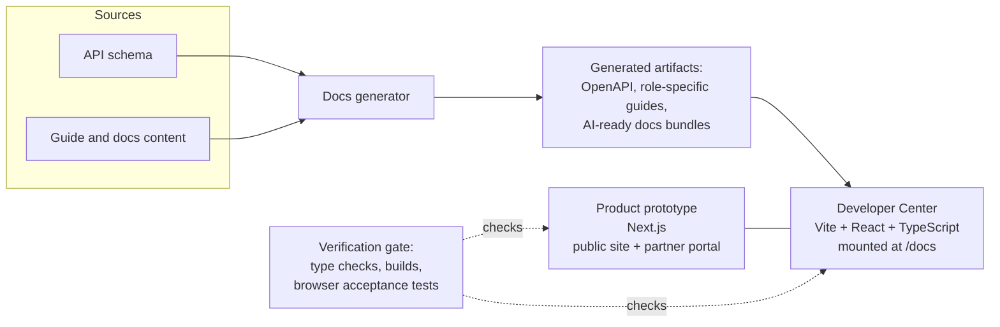

# Shipping developer experience for tokenized funds at WisdomTree

**Radha Ramanathan** · Product Management, WisdomTree Connect · Summer 2026

**In short:** I researched, designed, and shipped developer-facing work for WisdomTree Connect's API and docs: a partner integration blueprint, a self-serve sandbox credentials design ([with a code example](examples/sandbox-credentials/)), and a restructured Developer Center. After our team presented it to the Head of Product, the work went to Compliance and Legal for sign-off ahead of launch.

WisdomTree Connect gives institutions and partners API access to WisdomTree's tokenized funds. Over the summer I worked on the developer-facing side of that product: how a partner discovers a fund, understands the API, gets credentials, and builds an ordering flow. I did this as a PM who also shipped code, working directly in a React/TypeScript Developer Center and a Next.js product prototype alongside engineering.

This page walks through the problems I took on, the research behind them, what I built, and how the work changed as I learned. The source code and internal documents stay private to WisdomTree. I'm happy to go deeper on any of this in conversation.

---

## The problem

Tokenized funds are a new product category, and the people integrating them are usually fintech developers, not asset-management specialists. Three gaps stood out early:

1. **Docs explained endpoints, not jobs.** A developer could read what each API call did, but not how those calls fit together into a real product, such as letting a business buy a tokenized money market fund from inside its own app.
2. **Getting started had a dead end.** The Quickstart's first step assumed sandbox credentials, but the only way to get them was to complete full institutional onboarding first. A developer who just wanted to try the API had no path forward.
3. **The information architecture mixed audiences.** Integrator-facing content sat alongside privileged and administrative capabilities, making it harder for a partner to find what applied to them.

## Research

**Competitive benchmarking.** I compared developer onboarding at Stripe, Plaid, and Fireblocks, plus a direct tokenization competitor. The pattern was clear: the best developer platforms hand out a working sandbox credential at signup with no approval step, while slower ones route every developer through a human-mediated process before they can make a single call.

**Grounding in real integrations.** Rather than writing guides around invented personas, I studied a live distribution partner's actual buy flow and the API calls behind each step. I also audited every potential partner relationship to see which could support a new guide, and set a strict bar: a public announcement plus real integration steps. Only one cleared it, so I recommended against drafting the others rather than writing guides that implied integrations that didn't exist yet.

**Source-of-truth discipline.** Every claim in a guide had to trace back to the published API schema or canonical response examples. Where WisdomTree's own sources disagreed, I documented the conflict and routed it to the right owner instead of guessing.

## What I shipped

### 1. A partner integration blueprint

A task-led guide, "Offer tokenized funds," that reproduces a real partner's order form and places numbered markers on it. Each marker maps a piece of UI (product details, funding context, disclosures, review and submit) to the specific API call behind it. Instead of a procedure, it's a blueprint a partner's product and engineering teams can look at together.

The guide is deliberately honest about its edges. Where the published contract left a gap, the page says so in line rather than smoothing it over, which made it more useful to integrators and surfaced questions engineering needed to answer.

### 2. Self-serve sandbox credentials: proposal and prototype

I wrote a design proposal to remove the onboarding dead end, built on one principle: **sandbox and production are different risk surfaces.** Production involves real money, real counterparties, and real customer data, so it justifies full business verification. Sandbox has none of those risks, so it should only require proof of a real, reachable person.

The proposed flow was a short signup, email verification, automatic provisioning of a sandbox-only organization, and auto-issued credentials that match the real authentication contract. Production onboarding stays exactly as gated as before. I prototyped the end-state experience inside the Quickstart so reviewers could click through it, and sent the proposal to API Product, platform engineering, and Security with the specific decisions only they could make: verification bar, rate limits, data retention, and default scopes.

### 3. Developer Center information architecture

I restructured the smart contracts documentation around four destinations an integrator actually needs (overview, addresses and deployments, reading and transferring onchain, and security and audits) and moved privileged and admin capabilities out of the client integration story. I also produced refreshed artwork for the public discovery pages and the Developer Center overview.

## How I iterated

**I corrected my own claims when the evidence changed.** An early draft of the sandbox proposal said one-time secret reveal matched every benchmarked competitor. When I checked Plaid's sandbox documentation directly, it didn't: Plaid keeps sandbox secrets viewable in the dashboard because they carry no production risk. I fixed the proposal and made the distinction part of the design.

**The partner mockup went through seven design iterations,** each checked against source screenshots for layout and interaction fidelity, so the UI-to-API mapping worked at desktop and mobile widths.

**I worked inside an engineering quality gate.** Changes went through type checking, production builds, and automated browser acceptance tests. When a change touched generated documentation, I updated the source and regenerated rather than hand-editing output.

**I separated what I could decide from what I couldn't.** Repository-level choices I made and recorded. Anything touching legal, compliance, security, or the external API contract went to a named owner with the evidence attached.

## Architecture

The prototype is two applications presented as one integrated experience:

Documentation is generated from source inputs, so the API reference and the task guides draw from the same data and can't drift apart.

## Impact

My supervisor had our team present the work to WisdomTree's Head of Product. After that review, the Head of Product sent it to Compliance and Legal for sign-off, the final step before external release. The API and Developer Center docs are scheduled to go live before December 2026.

## What this work says about how I operate

I like being close to the build. Writing and shipping code alongside engineers let me test ideas in the real product instead of in slides, and it made my proposals more concrete. I also care about honesty in developer-facing products: a guide that admits where the contract is unclear earns more trust than one that hides it. And I try to be clear about ownership, deciding what's mine and routing the rest to the people accountable for it.

---

*Source code and internal materials for this work are private to WisdomTree.*
